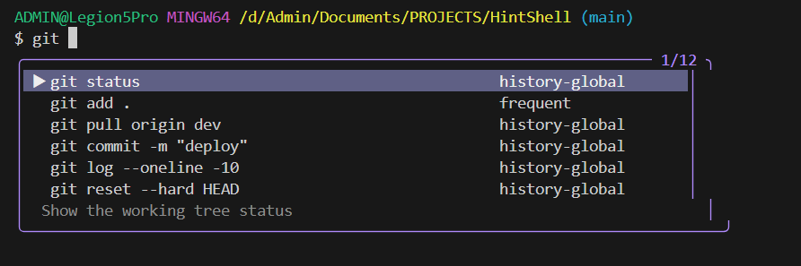
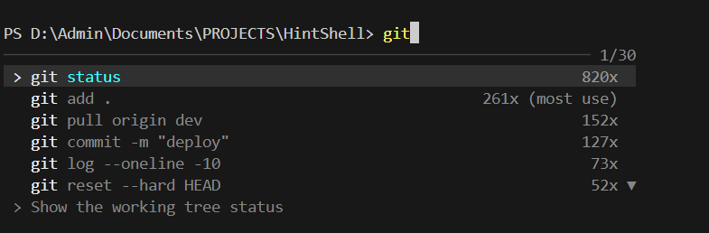
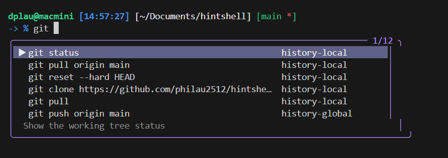
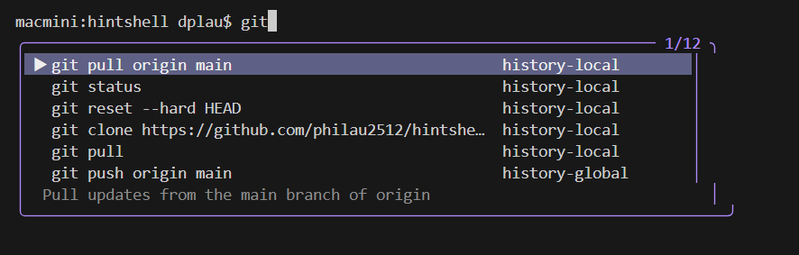

<p align="center">
  
</p>

<h1 align="center">HintShell</h1>
<p align="center"><strong>Local, Context-Aware Real-time Command Suggestions for Your Terminal</strong></p>

<p align="center">
  <a href="https://www.npmjs.com/package/hintshell"></a>
  <a href="https://www.rust-lang.org/"></a>
  <a href="#"></a>
  <a href="#"></a>
  <a href="https://opensource.org/licenses/MIT"></a>
</p>

<p align="center">
  HintShell is a <strong>local command-suggestion engine</strong> that <strong>embeds into your existing shell</strong> (PowerShell, Bash, or Zsh). It combines your command history with bounded context from the current directory and workspace, then presents suggestions without replacing native shell completion. Built with <strong>Rust</strong> for a small, responsive footprint.
</p>

<p align="center">
  
</p>
<p align="center">
  
</p>
<p align="center">
  
</p>
<p align="center">
  
</p>
---

## ⚡ Why HintShell?

Most shells offer basic, single-line autocomplete. HintShell adds a <strong>smart, interactive suggestion panel</strong> while keeping each shell authoritative for its own completion behavior: Bash and PSReadLine still own path and flag completion, and HintShell only supplies advisory command suggestions.

| Feature | HintShell | PowerShell <br>(PSReadLine) | Zsh <br>(zsh-autosuggestions) | Bash | Git Bash | Fish |
|---|:---:|:---:|:---:|:---:|:---:|:---:|
| **Suggestion UI** | Scrollable list | Single inline ghost | Single inline ghost | None | None | Single inline ghost |
| **Prefix matching** | ✅ | ✅ | ✅ | ✅ | ❌ | ✅ |
| **Frequency ranking** | ✅ | ❌ | ❌ | ❌ | ❌ | ✅ |
| **Smart ranking** | ✅ Recent → Default → Most Used → Others | ❌ | ❌ | ❌ | ❌ | ❌ |
| **Command descriptions** | ✅ | ❌ | ❌ | ❌ | ❌ | ❌ |
| **Cross-shell** | ✅ | PowerShell only | Zsh only | Bash only | — | Fish only |
| **Learns from history** | ✅ | ✅ | ✅ | ❌ | ❌ | ✅ |
| **Auto-start daemon** | ✅ | N/A | N/A | N/A | N/A | N/A |
| **600+ built-in commands** | ✅ | ❌ | ❌ | ❌ | ❌ | ❌ |
| **Works with any terminal** | ✅ | ✅ | ✅ | ✅ | ✅ | ✅ |

---

## 🚀 Installation (Recommended)

Follow these steps in order to get HintShell running on your machine.

### 1. Install Dependencies (macOS / Linux / Git Bash)
HintShell uses `fzf` to render the suggestion picker on Bash/Zsh (including **Git Bash** on Windows).
- **macOS**: `brew install fzf`
- **Linux (Ubuntu/Debian)**: `sudo apt install fzf`
- **Windows (Git Bash)**: `winget install junegunn.fzf` (or install fzf another way). PowerShell overlay does **not** require fzf.
- **Windows PowerShell**: No extra dependencies for the real-time overlay.

### 2. Install HintShell
Install via npm to get the latest pre-built binaries for your platform. Add `--foreground-scripts` to show the binary download, extraction, and setup output (this is also what `hs update` uses):
```bash
npm install -g hintshell@latest --foreground-scripts
```

### 3. Initialize Shell Integration
Run the init command to automatically configure your shell (`.zshrc`, `.bashrc`, or PowerShell profile):
```bash
hs init
```

### 4. Restart Terminal
Restart your terminal or reload your shell config to activate the hooks:
```bash
# Zsh
source ~/.zshrc

# Bash
source ~/.bashrc

# PowerShell
. $PROFILE
```

---

## 📖 Usage

### Git Bash / WSL2 Bash

After `hs init`, opening a normal interactive Git Bash or WSL2 Bash session automatically starts `hintshell bash`, which renders a local live overlay as you type. `fzf` is not required for this live mode.

| Key | Behaviour |
|---|---|
| **↑ / ↓** | Move through the suggestion list. With no overlay open they stay Bash's own history keys. |
| **Alt+↑ / Alt+↓** | Bash readline history, so the panel never competes with history for the same arrow. |
| **Tab** | Accept a compatible command suggestion. Path input such as `cd src/comp`, flags such as `git --ver`, and empty overlays are forwarded to Bash's native completion. |
| **→ / End** | Accept the inline ghost hint — the rest of the top compatible suggestion. Never for a destructive command, which needs the visible Tab path. |
| **Alt+→ / Ctrl+→** | Accept only the next word, Fish-style. |
| **Esc** | Hide the panel for the current line. It stays hidden until **Enter** or **Ctrl+Space**, so it does not pop back on the next keystroke. |
| **Ctrl+Space** | Bring the panel back and re-query without typing another character. |
| **Enter** | Execute through Bash. |

Everything else reaches Bash untouched: readline chords (**Ctrl+R**, **Ctrl+D**, **Ctrl+L**, **Ctrl+A/E/W/U/K/Y**, **Ctrl+P/N**), Meta bindings (**Alt+B**, **Alt+F**, **Alt+D**, **Alt+U**…), word motions (**Ctrl+←/→**), **Shift+Tab**, **Insert**, **PageUp/PageDown** and **F1–F12**.

- The overlay adapts to the terminal: it caps its width so no row wraps, drops the description column when narrow, shows fewer rows near the bottom, and falls back to a single inline ghost hint when a full frame would not fit (obeying `ghost_text`).
- A continued line (`PS2`, for example an unclosed quote) clears the panel instead of suggesting against a stale buffer, and the working directory is reported at every prompt, so `cd` changes are reflected in contextual suggestions.
- To bypass the wrapper for one shell, run:

```bash
HINTSHELL_DISABLE_AUTO_BASH=1 bash
```

- Git Bash keeps its existing Windows ConPTY backend. WSL2 uses a separate Unix pseudo-terminal backend and preserves the terminal's current working directory; neither changes PowerShell integration.
- Native Linux Bash retains the existing `Tab`/`fzf` picker instead of starting the live wrapper.
- Set `HINTSHELL_BASH` to an explicit `bash.exe` path on Git Bash. Set `HINTSHELL_DISABLE_LIVE_OVERLAY=1` to reject the wrapper in unsupported terminals.

> **Preview limitation:** the live wrapper requires an ANSI-capable terminal. For full-screen terminal applications, bypass the wrapper and open them from a normal Bash session.

### Git Bash Fast in VS Code

A VS Code Git Bash profile using `--norc --noprofile` intentionally skips `~/.bashrc`, so it also skips HintShell's standard Bash hook. Create a separate, minimal rcfile instead:

```bash
hs init --git-bash-fast
```

The command creates `~/.hintshell/git-bash-fast.bashrc`, which keeps the green/yellow prompt, initializes HintShell, and does **not** source your aliases, plugins, `.bashrc`, or `.bash_profile`. It prints a `Git Bash Fast + HintShell` profile for VS Code. Add that profile to user settings and select it manually; HintShell does not edit `settings.json` or change `terminal.integrated.defaultProfile.windows`.

The emitted profile has this shape (the rcfile path reflects your own user directory):

```json
"terminal.integrated.profiles.windows": {
  "Git Bash Fast + HintShell": {
    "path": "C:\\Users\\<you>\\.hintshell\\bin\\hintshell.exe",
    "args": ["bash", "--rcfile", "/c/Users/<you>/.hintshell/git-bash-fast.bashrc", "-i"],
    "icon": "terminal-bash"
  }
}
```

The live overlay needs VS Code's ANSI-capable integrated terminal and Windows ConPTY. Select the original `Git Bash Fast` profile for a session without HintShell. Within the dedicated profile, set `HINTSHELL_DISABLE_AUTO_BASH=1` before starting Bash to bypass the wrapper for a session.

### macOS Bash / Zsh live overlay

On macOS, `hs init` configures the realtime overlay automatically for interactive Bash and Zsh sessions. For Bash login shells, it also adds a managed block to `~/.bash_profile` that loads `~/.bashrc`, so the overlay starts in macOS Terminal and iTerm2 without manual profile edits.

```bash
hs init
```

Open a new terminal after initialization. The wrapper starts the same shell as a child through the Unix pseudo-terminal backend. It preserves the opening directory and synchronizes the current directory after each prompt, so contextual suggestions follow `cd` changes.

- The key bindings are the Git Bash table above: **↑/↓** and **Alt+↑/↓**, **Tab**, **→** (inline hint), **Alt+→** (next word), **Esc** (sticky hide) and **Ctrl+Space** (re-open).
- **Tab** keeps native Bash/Zsh path and flag completion authoritative; HintShell accepts only compatible command-prefix suggestions.
- **Interactive programs** such as `gh auth login`, `fzf`, `vim`, and `nano` receive raw terminal input while running; the overlay resumes automatically at the next prompt.
- **Bash escape hatch:** `HINTSHELL_DISABLE_AUTO_BASH=1 bash`
- **Zsh escape hatch:** `HINTSHELL_DISABLE_AUTO_ZSH=1 zsh`
- Run `hs uninstall` to remove both the shell hook and the managed Bash login block.
- Use an escape hatch for full-screen terminal applications or any profile whose startup plugins are not compatible with a PTY wrapper.

### Zsh / Bash (macOS/Linux)

**Tab-to-Suggest** uses `fzf` when available. Type `git ` and press **Tab** to open a ranked command picker; **Enter** fills the command line. If `fzf` is unavailable, HintShell uses the top matching command without emitting an executable-path error.

### Context-aware suggestions & Smart Directory Navigation

Each request includes the current working directory and shell. HintShell merges bounded contextual candidates with local and global history, then ranks the combined list once.

- **Smart `cd` Suggestions**: Typing `cd ` automatically lists directories in your current folder sorted by recent modification time (`mtime`), while keeping your #1 most frequent/recent command on top. Shortcut completions like `cd ..` and `cd -` are included out of the box.
- **Deep Tech Stack Detection**: Automatically senses workspace marker files (`pnpm-lock.yaml`, `bun.lockb`, `yarn.lock`, `Cargo.toml`, `docker-compose.yml`, `.git/index`) to recommend contextual dev, build, test, and git workflow commands.
- **Typo Tolerance & Substring Matching**: Tolerates single-character command typos (`gti` $\rightarrow$ `git`, `dcoker` $\rightarrow$ `docker`) with automatic substring (`contains`) fallback matching.
- **Paths & Tool Arguments**: Paths for supported argument positions, including `cd`, `pushd`, `mkdir`, `rmdir`, `cat`, `rg`, `git add`, and `docker build`.
- **Entity Suggestions**: Git branches/remotes, npm-family scripts, Docker entities, SSH hosts, and zoxide directories when the command and local runtime are available.
- **Privacy & Performance**: Filesystem scans, workspace detection, and external commands are bounded, cached where appropriate, and fail closed. Context candidates never write themselves to command history.

### 🎨 Customization (`~/.hintshell/config.toml`)

HintShell creates a configuration file at `~/.hintshell/config.toml` automatically on initial setup. **The same file styles the live Bash/Zsh overlay and the PowerShell module**, so one edit applies to every surface.

```toml
# Frame colour. Aliases are accepted; an unknown name falls back to purple and `hs config` says so.
# - Apple-style glow (24-bit gradient): "apple" | "siri" | "apple-intelligence" | "glow" | "neon"
# - Multi-colour spectrum (24-bit gradient): "rainbow" | "gemini" | "gradient" | "aurora"
# - Solid tones: "purple" (default) | "blue" | "cyan" | "green" | "yellow" | "gold" | "orange"
#                "pink" | "rose" | "magenta" | "red" | "minimal" | "gray" | "grey"
border_color = "apple"

# Rows shown in the overlay (default: 6). Clamped to 3..=10; anything outside is reported.
max_visible = 6

# Inline ghost text next to the cursor. Also the fallback used when the terminal is too
# short or too narrow to draw a full frame (default: true).
ghost_text = true
```

```bash
hs config   # effective values, the palette, 24-bit support, and any setting being ignored
```

Gradient presets are painted with 24-bit colour. When `COLORTERM` does not advertise `truecolor`/`24bit` (legacy conhost, `TERM=xterm-256color`), the frame degrades to the closest 256-colour code instead of showing escape-sequence noise.

### 🔎 How to read a suggestion row

The right-hand column answers "where did this come from?", "how did it match?" and "how often?". The same vocabulary is used in Bash, Zsh and PowerShell.

| Marker | Meaning |
|---|---|
| `here` | You ran it in this directory before — the strongest signal. |
| `history` | You ran it somewhere else before. |
| `most used` | One of your most frequent commands. |
| `starter` | From the built-in catalogue of 600+ documented commands. |
| `path` `scripts` `git` `docker` `ssh hosts` `folders` `cargo` | Contextual candidate generated from a real path, project script, branch, container, host, folder or crate. |
| *(no tag)* | Your input is an actual prefix of the command. |
| `~` | Substring or fuzzy match — letters present but not adjacent; read the row before accepting. |
| `≈` | Typo-tolerant match (`gti` → `git`). |
| `Nx` | Used N times (only shown when the counter is real; contextual candidates show none). |
| `!` and `[!] risky` | Destructive command (`rm -rf`, `git reset --hard`, `docker system prune -af`, `terraform destroy`…). **→** and **Alt+→** refuse it: use **Tab** on the visible row so you have read it first. |

The description line explains what the selected command does, and falls back to `used Nx · here` or `no description` so it is never an empty gap.

### PowerShell (Windows/Unix)

**Real-time Overlay**: Suggestions appear automatically as a floating panel beneath your cursor as you type, using the same `~/.hintshell/config.toml`, the same labels and the same tiers as the Bash overlay.

- **↑ / ↓** navigate the list; with no panel open they stay history keys.
- **Tab** accept · **→** accept the inline hint · **Alt+→** accept one word.
- **Esc** hides the panel for the current line (sticky); **Ctrl+Space** brings it back.
- **Ctrl+R** is still PowerShell's own history search, and non-ASCII input (e.g. Vietnamese folder names) is suggested like anything else.

Text uses bold/dim and underline as well as colour, and the panel no longer forces a bright foreground, so rows stay readable on light themes.

---

## ✨ What's new in 0.3.4

- `hs init` automatically enables the live overlay for macOS Bash and Zsh; no opt-in environment variable is required.
- macOS Bash login sessions load `.bashrc` through a HintShell-managed block in `.bash_profile`, so the overlay works in Terminal and iTerm2.
- `hs uninstall` removes both the shell hook and HintShell's managed Bash login block.
- Git Bash and WSL2 retain their live-overlay backends; Linux Bash/Zsh outside WSL2 continue using Tab/fzf.

## 🔄 Updating

While the daemon is running, Windows locks `hintshell-core.exe`. Use:

```bash
# Recommended
hs update

# Or raw npm — postinstall stops the daemon and runs init
npm i -g hintshell@latest
```

If you still hit a file lock (`os error 32` / "being used by another process"):

```bash
hs stop
# or: taskkill /F /IM hintshell-core.exe
npm i -g hintshell@latest
hintshell init
```

## 🗑️ Uninstallation

If you need to remove HintShell, it now comes with a clean uninstaller that handles everything for you:

```bash
# 1. Run the official uninstaller
hs uninstall

# 2. (Optional) Remove the NPM package
npm uninstall -g hintshell
```
*Note: `hs uninstall` stops the daemon, removes hook lines from your shell configs, and deletes binaries from `~/.hintshell/bin`, but keeps your history database (`history.db`) safe.*

---

## 🏗️ CLI Reference

```bash
hs status      # Check if the daemon is running and see stats
hs start       # Manually start the daemon
hs stop        # Stop the daemon
hs config      # Show the effective overlay config and report values it ignores
hs update      # Stop daemon, npm install -g, init, restart
hs uninstall   # Completely remove shell integration and binaries
```

---

## 🏗️ Architecture

HintShell is a **client-daemon** system. It does **not** replace your terminal or shell. It plugs in via a thin hook.

```
┌─────────────────────────────────┐
│  Your Terminal                  │
│  (Windows Terminal, iTerm2,     │
│   Alacritty, any terminal)      │
│                                 │
│  ┌───────────────────────────┐  │
│  │  Your Shell               │  │
│  │  (PowerShell / Bash / Zsh)│  │
│  │       ▲                   │  │
│  │       │ hook / module     │  │
│  │       ▼                   │  │
│  │  ┌─────────┐    IPC    ┌──────────────┐
│  │  │   hs    │◄─────────►│ hintshell    │
│  │  │  (CLI)  │ Named Pipe│ -core        │
│  │  └─────────┘  or UDS   │ (Daemon)     │
│  │                        │ SQLite+Fuzzy │
│  │                        └──────────────┘
│  └───────────────────────────┘  │
└─────────────────────────────────┘
```

---

## 🤝 Contributing & License

Contributions are welcome! Built with 🦀 Rust for speed and safety. 
Licensed under **MIT**.

<p align="left">
  <strong>Stop memorizing commands. Let HintShell remember for you.</strong>
</p>
